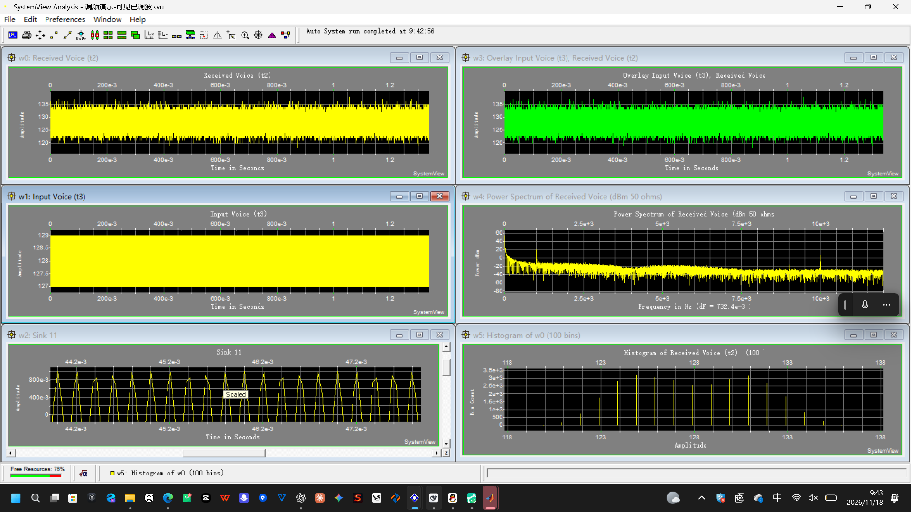

# SystemView 5.0 automation

Drive **ELANIX SystemView 5.0** (the 1999 VB6 program `SysVu_32.exe`) from the
command line: open a `.svu` system, read what each token is, change device
parameters, run the simulation, and capture the plot windows as PNG.

No COM, no DLL, no OCR — it enumerates real windows and clicks them, which is
the only way in: the program has no scripting interface and stores `.svu` as
an opaque binary.

```
python scripts/sim.py --file "E:\path\demo.svu" --carrier 5000 --mod-gain 30 --out out\
```

```
out\demo-full.png        full-screen capture of the six analysis windows
out\result.json          {"ok": true, "images": [...], "elapsed_s": 12.4, ...}
```

What the capture looks like (`examples/调频演示-可见已调波-full.png`, produced by
this script — six windows, and `w2: Sink 11` is the FM wave itself):



## Why this exists

SystemView is still used for 通信原理 / 信号与系统 coursework, but it cannot be
scripted and its `.svu` files cannot be parsed. Everything here was recovered
by watching the program: which status text it prints, which dialog field is
which, how long a run takes, and what makes a plot *look* like an FM wave.
Those findings are the actual value — the scripts are just the delivery.

## Requirements

| | |
|---|---|
| OS | Windows 10 / 11, interactive desktop (it moves the real cursor) |
| Screen | 1920×1080 at 125% scaling, single monitor |
| Python | 3.10+ with `Pillow` (`pip install -r requirements.txt`) |
| SystemView | 5.0 installed, default `E:\SYSTEMVIEW\SysVu_32.exe` |
| Privileges | none beyond a normal user session |

Coordinates in `config.json` assume that screen setup. On anything else run
`python scripts/sv.py list` and `python scripts/token_status.py` once, then
adjust — every click is re-measured where the program allows it.

## Install

Agent Skills layout — drop the folder in and it is discovered by name:

```bash
# personal
git clone <this folder> ~/.claude/skills/systemview-automation
# or project-scoped
cp -r systemview-automation <project>/.claude/skills/
```

The folder name must stay `systemview-automation`: the frontmatter `name` has
to equal its parent directory.

## Usage

```bash
# 1. just open and run, capture everything
python scripts/sim.py --file "E:\通信原理课程设计\FM_SystemView\调频演示-可见已调波.svu" --out out\

# 2. change the carrier and modulation index first (this is what makes an FM
#    waveform visible — see references/params.md)
python scripts/sim.py --file demo.svu --carrier 5000 --mod-gain 30 --out out\

# 3. also zoom the modulated-wave plot to a few milliseconds
python scripts/sim.py --file demo.svu --zoom 0.0437 0.0477 --out out\

# 4. dry run / machine-readable
python scripts/sim.py --file demo.svu --dry-run
python scripts/sim.py --file demo.svu --json
```

| flag | meaning |
|---|---|
| `--file` | `.svu` to open (required) |
| `--out` | output directory, default `out` |
| `--carrier` / `--mod-gain` / `--amplitude` | rewrite FM/VCO before running |
| `--zoom X0 X1` | drag-select that time window in the plot |
| `--timeout` | seconds to wait for the plots to settle (default 45) |
| `--config` | JSON file replacing coordinates from `config.json` |
| `--no-launch` | assume SystemView is already open |
| `--dry-run` | print the plan, touch nothing |
| `--json` | result object on stdout |

Exit codes: `0` ok · `2` not launchable · `3` open failed · `4` parameters
dialog missing · `5` never settled.

### Reading tokens instead of running

```bash
python scripts/token_status.py "SystemView - demo.svu" tokens.png 381 477 498 468
```

Writes one strip per token with its status line, e.g.

```
Function: Freq Mod,  Input from 5, Output to 6, 11.
Adder: Non Parametric,  Input from 1, 7, Output to 8, 9.
```

That single line is usually enough to answer "what does this system actually
do?" without decompiling anything.

## How you know a figure is fresh

The analysis toolbar prints `Auto System run completed at HH:MM:SS`. If that
timestamp is not from your run, you are looking at the previous result — a
`Ctrl+D` only reopens the window, it does not recompute. `sim.py` waits for
the screen to stop changing instead of trusting the clock.

## Troubleshooting

| symptom | cause | fix |
|---|---|---|
| clicks land on the palette / nothing happens | window not maximized, canvas scrolled | `sv.py max <hwnd>`, re-measure |
| screenshot shows another app | background window never came forward | `token_status.py` forces TOPMOST; or `sv.py hide` first |
| dialog found but text not written | wrong handle (searched another dialog) | `openfile.py dump "<title>"`, pick the edit with `*.svu` |
| parameter silently reverted | submitted via Source Library's OK | edit through right-click → `Edit Parameters…` |
| plots look identical after a change | `Ctrl+D` doesn't recompute | use `Shift+F5` (`Run System and Auto Plot`) |

More, with symptoms and root causes: `references/pitfalls.md`.

## Limits

- One screen, fixed DPI. Multi-monitor or 100%/150% scaling needs re-measuring.
- No optical character recognition: numbers are read by a human or a vision
  model from the screenshot, never parsed from pixels.
- Canvas token coordinates are static. If a system's tokens move, pass a new
  `--config`.
- Do not run it while you are using the mouse — it takes over the cursor.

## License

MIT — see `LICENSE`.
