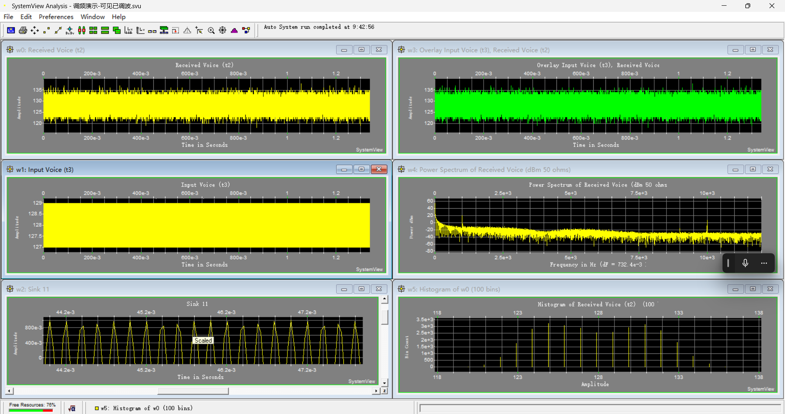
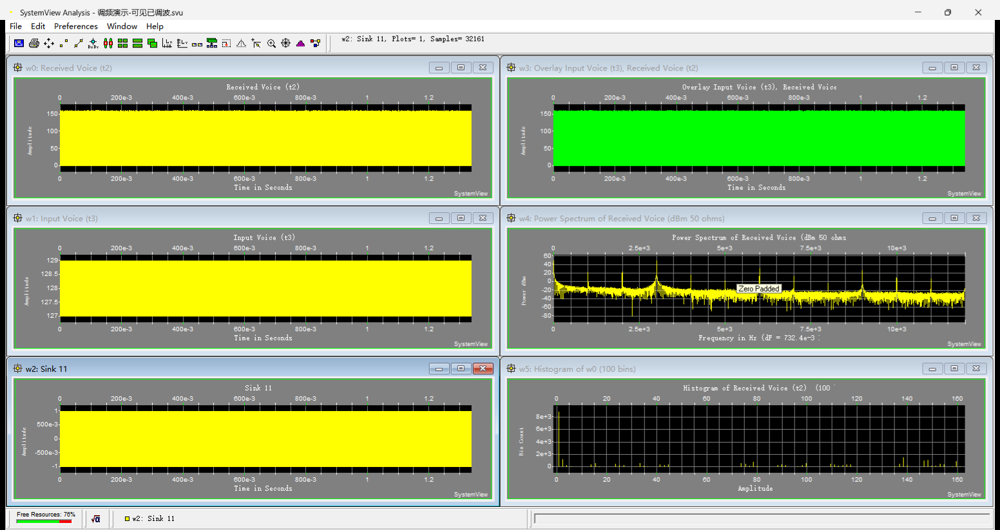

# SystemView 5.0 仿真自动化

[](#环境要求)
[](requirements.txt)
[](LICENSE)
[](SKILL.md)

一句话驱动 **ELANIX SystemView 5.0**（1999 年的 VB6 程序 `SysVu_32.exe`）：
打开 `.svu` 系统 → 读出每个 token 是什么 → 改器件参数 → 跑仿真 → 把分析窗口
截成 PNG。

**没有 COM、没有 DLL、没有 OCR**——它靠枚举真实窗口并点击操作，因为这是唯一的
入口：这个程序没有任何脚本接口，`.svu` 又是不公开的二进制格式。



*一条命令，一张图。调频系统的六个分析窗口：原始语音、恢复语音、两者叠加、功率谱、
直方图——以及 `w2: Sink 11`，就是已调波本身。*

```
python scripts/sim.py --file "E:\path\demo.svu" --set carrier=5000 --set mod_gain=30 --out out\
```

```
out\demo-full.png        六个分析窗口的全屏截图
out\demo.png             同一张图裁到分析窗口（无任务栏、无遮挡）
out\result.json          {"ok": true, "images": [...], "elapsed_s": 12.4, ...}
```

改一个器件参数，图就跟着变——下面是 `--set carrier=1500 --set mod_gain=60`
的运行结果：载波从默认的 5 kHz 挪到 1.5 kHz，`w2` 的疏密和 `w4` 的谱线一起变了。



## 为什么会有这个项目

SystemView 至今仍被用在 **通信原理 / 信号与系统** 的课程设计里，但它既不能被
脚本驱动，`.svu` 也解析不了。这里所有东西都是**看着程序本身反推出来的**：它
在状态栏打印什么字、哪个对话框的哪个框对应哪个参数、一次运行要跑多久、以及
什么样的参数才能让一条曲线"看起来像调频波"。

这些结论才是这个仓库真正的价值，脚本只是把它们交付出来的壳。

## 环境要求

| | |
|---|---|
| 操作系统 | Windows 10 / 11，需要有可交互的桌面（它会移动真实鼠标） |
| 屏幕 | 1920×1080、缩放 125%、单显示器 |
| Python | 3.10+ 且装 `Pillow`（`pip install -r requirements.txt`） |
| SystemView | 5.0，默认路径 `E:\SYSTEMVIEW\SysVu_32.exe` |
| 权限 | 普通用户会话即可，不需要管理员 |

`config.json` 里的坐标按上面这套屏幕标定。屏幕不一样时先跑一次
`python scripts/sv.py list` 和 `python scripts/token_status.py`，再按实际位置调整——
凡是程序允许的地方，每次点击都是现测的。

## 安装：不绑定任何一家智能体

**它本质上只是三个 Python 脚本 + 一份说明。** 没有 SDK、没有账号、没有专有协议，
所以任何能执行命令的智能体都能用（Claude Code、Codex CLI、Cursor、Cline、
Windsurf、Gemini CLI、Aider、自研 agent、CI 机器人，或者你自己开一个终端）。

```bash
git clone https://github.com/xiazhuo123456789/systemview-automation.git
cd systemview-automation
pip install -r requirements.txt

# 够用了：不需要"装"，直接跑
python scripts/sim.py --file "D:\lab\demo.svu" --out out\ --json
```

如果你用的运行时支持 **Agent Skills** 目录规范（`SKILL.md` + frontmatter，靠
`description` 触发），把这个目录放进它的 skills 目录即可，**目录名必须保持
`systemview-automation`**（规范要求 `name` 与父目录同名）：

```bash
# Claude Code：个人级 / 项目级
git clone <本仓库> ~/.claude/skills/systemview-automation
cp -r systemview-automation <project>/.claude/skills/

# 其它运行时（Codex CLI / Cursor / Cline / 自研）请按各自约定放置；
# 即使完全不认 SKILL.md，也只要对它说一句"先读 SKILL.md，按里面的命令执行"。
```

想包成 function calling / MCP / LangChain tool，见
[`docs/integrations.md`](docs/integrations.md)：三层接入方式（纯 CLI → Skills 目录
→ 函数封装）和一份现成的 JSON schema，适配层通常 20 行以内。

## 作为 MCP 服务器使用（已内置，零依赖）

`scripts/mcp_server.py` 是一个自带实现的 MCP server（stdio + JSON-RPC，不装任何
SDK），任何支持 MCP 的客户端都能直接连：Claude Desktop、Claude Code、Cursor、
Cline、Zed、Continue、自研 agent。

在客户端的配置里加一段即可（路径换成你 clone 下来的位置）：

```json
{
  "mcpServers": {
    "systemview": {
      "command": "python",
      "args": ["E:\\path\\to\\systemview-automation\\scripts\\mcp_server.py"]
    }
  }
}
```

| 工具 | 作用 | 主要参数 |
|---|---|---|
| `systemview_run` | 打开 `.svu` → 改器件参数 → 跑仿真 → 截图，返回路径 + 内嵌图片 | `file`（必填）、`set`、`out`、`timeout`、`zoom` |
| `systemview_inspect` | 只读：列出正在运行的 SystemView 窗口；给了 `file` 还会返回 token 清单 | `file`（可选） |
| `systemview_screenshot` | 只截图、不跑仿真；`kind=design` 可抓设计画布 | `title`、`kind`、`out`、`name` |

工具返回的是标准 MCP `content`：一段 JSON 文本 + 一张 PNG（`image` block），
所以模型能直接"看到"图，而不是只拿到文件路径。手工检查连通性：

```bash
echo '{"jsonrpc":"2.0","id":1,"method":"tools/list"}' | python scripts/mcp_server.py
```

## 用法

```bash
# 1. 只打开并运行，把所有窗口截图
python scripts/sim.py --file "E:\通信原理课程设计\FM_SystemView\调频演示-可见已调波.svu" --out out\

# 2. 先改载波与调制增益（这正是让调频波形"看得见"的关键，见 references/params.md）
python scripts/sim.py --file demo.svu --set carrier=5000 --set mod_gain=30 --out out\

# 2b. 旧参数仍然可用，含义相同
python scripts/sim.py --file demo.svu --carrier 5000 --mod-gain 30 --out out\

# 3. 顺便把已调波那张图放大到几毫秒
python scripts/sim.py --file demo.svu --zoom 0.0437 0.0477 --out out\

# 4. 只看计划 / 要机器可读结果 / 看匹配到哪个 profile
python scripts/sim.py --file demo.svu --dry-run
python scripts/sim.py --file demo.svu --json
python scripts/sim.py --file demo.svu --print-profile
```

| 参数 | 含义 |
|---|---|
| `--file` | 要打开的 `.svu`（必填） |
| `--out` | 输出目录，默认 `out` |
| `--set NAME=VALUE` | 运行前写入 profile 里的字段；可重复，任何 system profile 通用 |
| `--profile` | 指定 profile JSON（默认按文件名自动匹配 `systems/*.json`） |
| `--print-profile` | 打印解析出的 profile 并退出——完全不碰 GUI |
| `--carrier` / `--mod-gain` / `--amplitude` | `--set carrier=…` 等写法的简写，为兼容旧用法保留 |
| `--zoom X0 X1` | 在图里框选这段时间窗 |
| `--timeout` | 等图稳定下来的秒数（默认 45） |
| `--config` | 用另一个 JSON 覆盖 `config.json` 里的坐标 |
| `--no-launch` | 假定 SystemView 已经开着 |
| `--dry-run` | 只打印计划，什么都不动 |
| `--json` | 在 stdout 输出结果对象 |

退出码：`0` 成功 · `2` 起不来 · `3` 打开失败 · `4` 找不到参数对话框 ·
`5` 图一直没稳定。

### 只读 token，不跑仿真

```bash
python scripts/token_status.py "SystemView - demo.svu" tokens.png 381 477 498 468
```

每个 token 一行状态条，例如：

```
Function: Freq Mod,  Input from 5, Output to 6, 11.
Adder: Non Parametric,  Input from 1, 7, Output to 8, 9.
```

通常这一行就足以回答"这个系统到底在干什么"，不用反编译任何东西。

## 怎么确认这张图是这次跑出来的

分析窗口工具栏会打印 `Auto System run completed at HH:MM:SS`。时间戳不是你这次的，
说明你看到的是上一次的结果——`Ctrl+D` 只是把窗口调出来，不会重算。`sim.py` 不
信时钟，而是等画面停止变化。

## 常见故障

| 现象 | 原因 | 处理 |
|---|---|---|
| 点击落在左侧调色板上 / 毫无反应 | 窗口没最大化，或画布被滚过 | `sv.py max <hwnd>`，重新测量坐标 |
| 截图里是别的程序 | 后台窗口没被抬到前台 | `token_status.py` 会强制置顶；或先 `sv.py hide` |
| 找到对话框但字写不进去 | 句柄找错了（搜到了别的对话框） | `openfile.py dump "<标题>"`，挑带 `*.svu` 的那个输入框 |
| 参数改了又被还原 | 是从 Source Library 的 OK 提交的 | 走右键 → `Edit Parameters…`（坑 §17） |
| 改完参数图一模一样 | `Ctrl+D` 不会重算 | 用 `Shift+F5`（`Run System and Auto Plot`） |
| `WARNING: no text box for 'Mod Gain'` | 分组标题是 `ThunderRT6Frame`，不是 `Label` | 保留 `field_edit` 的 frame-caption 分支（坑 §18） |
| 字段写了，对话框却不关 | OK 点到了 `Apply to tokens` | `profile.pick` 里精确标题优先（坑 §19） |
| 对 OK 发 `BM_CLICK` 没反应 | 置顶的设计窗把点击吃掉了 | 先把对话框抬到前台（坑 §20） |
| 截图后 `w2` 的缩放没了 | 分析窗被 resize 过 | 用 `hold_front` 只抬不 resize（坑 §21） |

更多症状与根因见 [`references/pitfalls.md`](references/pitfalls.md)。

## 移植到你自己的系统

这个 FM 例子除了一个 JSON 文件之外没有任何硬编码。**system profile**
（`systems/*.json`）声明：打开哪个对话框、token 在画布的哪里、以及对话框里的
标签名对应哪个参数名：

```bash
cp systems/_template.json systems/my-system.json     # 填好之后：
python scripts/sim.py --file my.svu --print-profile  # 只解析，不碰 GUI
python scripts/sim.py --file my.svu --set carrier=5000 --out out
```

`sim.py` 按文件名子串匹配 profile（最长匹配优先）；以 `_` 开头的文件不参与匹配，
所以模板不会被误用。对话框字段是**按标签文字**定位的（`Amplitude (v)` →
`"Amplitude"`），不是按像素顺序，因此对话框挪位也找得到。

三条扩展配方（加 profile、加第二个器件对话框、加导出之类的新步骤）以及
`sv.py` 全部原语的契约，见 [`docs/extending.md`](docs/extending.md)。

## 换一台机器、换一个版本：让它自己检测

代码里**没有**"如果版本是 X 就……"的分支——版本矩阵注定过期，而我只见过 5.0。
换机器或换版本时，不要改代码，先跑一次自检：

```bash
python scripts/probe.py --out probe --json probe.json
```

它只读不点：列出 `SystemView*` 窗口、读画布原点与 `.exe` 文件版本、抓
`probe/design.png`（用来核对 token 有没有挪位）、`probe/token_status.png`
（用来确认"点下去真的点到了 token"，因为状态栏是 VB 自绘、读不到文本）。
`checks[].ok=false` 的条目就是要人工看一眼的地方。

五步完整流程、每个版本可能变的东西（窗口类名、画布原点、运行快捷键、
保存提示按钮文本）以及"点空了 / 显示旧图"的排查，见
[`references/versions.md`](references/versions.md)。

## 检索关键词 / Search terms

`SystemView` · `ELANIX SystemView 5.0` · `SysVu_32` · `.svu` · `通信原理课程设计` ·
`调频` / `FM modulation` · `信号与系统 仿真` · `仿真自动化` · `GUI automation` ·
`Windows GUI RPA` · `PyAutoGUI alternative` · `pywinauto alternative` ·
`no-COM legacy app automation` · `agent skill` · `agent-agnostic` · `SKILL.md` ·
`Claude Code` · `Codex CLI` · `Cursor` · `Cline` · `Gemini CLI` · `MCP tool` ·
`function calling` · `LLM tool use`

## 限制

- 单屏、固定 DPI。多显示器或 100%/150% 缩放需要重新测量。
- 不做光学字符识别：图上的数字由人或视觉模型读，程序从不从像素里解析数值。
- 画布上的 token 坐标是静态的。系统改动导致 token 移动时，传一份新的 `--config`。
- 运行时不要同时用鼠标——它会接管光标。

## 许可证

MIT，见 `LICENSE`。
